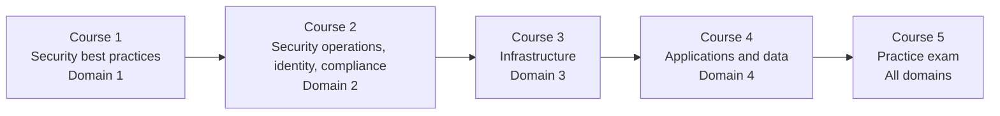

# SC-100: Microsoft Cybersecurity Architect Skill Path

**This repository holds every learner resource for my Pluralsight skill path,
[SC-100: Microsoft Cybersecurity Architect](https://www.pluralsight.com/paths/sc-100-microsoft-cybersecurity-architect).**
You get the slides for every module, the lab code behind every demo, an offline study page for each
course with the Microsoft documentation behind every clip, the full skills-measured map, and a
tracker of the product names Microsoft has changed out from under the exam.

If you're watching the courses, open the folder for the course you're on and start with its
README. If you're studying without the videos, start with the
[skills-measured map](docs/SC-100-Skills-Measured.md) and work from the objectives you can't yet
defend out loud.

## The skill path

The path follows the exam outline one domain per course, so the course you're on tells you which
part of the exam you're preparing for.

| Course on Pluralsight | Exam domain | Weight | Files in this repo |
|---|---|---|---|
| 1. [SC-100: Designing Solutions with Security Best Practices](https://www.pluralsight.com/courses/sc-100--designing-solutions-with-security-best-practices) | 1 | 20-25% | [courses/01-security-best-practices](courses/01-security-best-practices/) |
| 2. [SC-100: Designing Security Operations, Identity, and Compliance Capabilities](https://www.pluralsight.com/courses/sc-100--designing-security-operations--identity--and-compliance-capabilities) | 2 | 25-30% | [courses/02-secops-identity-compliance](courses/02-secops-identity-compliance/) |
| 3. [SC-100: Designing Security Solutions for Infrastructure](https://www.pluralsight.com/courses/sc-100--designing-security-solutions-for-infrastructure) | 3 | 25-30% | [courses/03-infrastructure](courses/03-infrastructure/) |
| 4. SC-100: Designing Security Solutions for Applications and Data | 4 | 20-25% | [courses/04-applications-and-data](courses/04-applications-and-data/) |
| 5. Practice exam | All | | Lives on Pluralsight. Its items aren't published here, so they stay useful as a real check. |

Course 4 is publishing on Pluralsight now, and it joins the
[skill path](https://www.pluralsight.com/paths/sc-100-microsoft-cybersecurity-architect) as soon as
it's live. Its files are already here.

## Find your module's files

Every course folder has a README that maps each module to its slides, its lab folder, its
prerequisites, the exact run order and the cleanup commands. Slide and lab files are numbered to
match the module number in the Pluralsight player.

**Course 1: SC-100: Designing Solutions with Security Best Practices**

- Module 1: Design Ransomware Resilience
- Module 2: Design to Reference Architectures and Benchmarks
- Module 3: Design Governance with CAF and the Well-Architected Framework
- Module 4: Design for Secure AI Adoption and DevSecOps

**Course 2: SC-100: Designing Security Operations, Identity, and Compliance Capabilities**

- Module 1: Design security operations for one estate
- Module 2: Design identity for human, workload, and agent principals
- Module 3: Design continuous authorization and harden the directory
- Module 4: Design privileged access that expires
- Module 5: Design compliance you can evidence

**Course 3: SC-100: Designing Security Solutions for Infrastructure**

- Module 1: Design posture management that follows the attack path
- Module 2: Specify endpoint security from servers to the plant floor
- Module 3: Specify security for SaaS, PaaS, IaaS, and AI workloads
- Module 4: Evaluate network security and Security Service Edge

**Course 4: SC-100: Designing Security Solutions for Applications and Data**

- Module 1: Evaluate Microsoft 365 security for the Copilot rollout
- Module 2: Design an application security program for the release train
- Module 3: Map security technologies to application requirements
- Module 4: Design data security from classification to the AI index

Every course folder keeps its slides in `slides/mNN-<module>-slides.pdf`: the slides exactly as
they appear in the course, as a PDF. Courses 1, 2 and 4 keep their lab
code under `code/mNN-<demo>/`. Course 3 keeps it under `scripts/mNN-<demo>/`, which is the layout
its Pluralsight download ships with, so the two always match.

## Study references

| File | Use it for |
|---|---|
| [docs/SC-100-Skills-Measured.md](docs/SC-100-Skills-Measured.md) | Every objective, word for word, Microsoft's recent change logs, and the topics where the free Microsoft Learn path runs thin |
| [docs/SC-100-Names-and-Status.md](docs/SC-100-Names-and-Status.md) | Renamed and retired products, MCSB version traps, and the places where Microsoft's own pages disagree |
| `SC-100-Course-N-Resources.html` in each course folder | The Microsoft documentation behind every clip, organized module by module, with every link checked live. Download the file and open it in any browser; it works offline |

Read the names-and-status page before exam day. Training data, older books and AI chat answers
will confidently hand you a product Microsoft retired, and the exam is current.

Microsoft's free training for the exam pairs well with this path, one learning path per domain:
[best practices and priorities](https://learn.microsoft.com/en-us/training/paths/sc-100-design-solutions-best-practices-priorities/),
[security operations, identity, and compliance](https://learn.microsoft.com/en-us/training/paths/sc-100-design-operations-identity-compliance-capabilities/),
[infrastructure](https://learn.microsoft.com/en-us/training/paths/sc-100-design-security-solutions-infrastructure/), and
[applications and data](https://learn.microsoft.com/en-us/training/paths/sc-100-design-security-solutions-applications-data/).
Start from the official [SC-100 study guide](https://learn.microsoft.com/en-us/credentials/certifications/resources/study-guides/sc-100)
and take Microsoft's free [practice assessment](https://learn.microsoft.com/en-us/credentials/certifications/exams/sc-100/practice/assessment)
once you've finished a course.

## Before you run a lab

**The labs deploy real, billable Azure resources, and some of them change a Microsoft Entra or
Microsoft 365 tenant.** Here's how I'd run every one of them:

1. **Use a subscription and a tenant you own for learning, never production.** Several labs plant a
   deliberate weakness, such as an over-broad permission, so there's something for you to find.
2. **Sign in first.** Every script takes its subscription and tenant from your own `az login` (or
   your own Microsoft Graph sign-in for the tenant labs). Nothing in this repo is pinned to my
   environment. To target something else, pass `-SubscriptionId` or `-TenantId`, or set
   `AZURE_SUBSCRIPTION_ID` and `AZURE_TENANT_ID`.
3. **Read the module README before you run anything.** It lists the licenses and admin roles the lab
   needs, because some demos depend on Microsoft Entra ID P2, Microsoft Defender plans or Microsoft
   Agent 365, and a missing license fails in ways that look like a bug.
4. **Remove the lab the same day.** Every lab ships with its own remove command, and it deletes only
   what that lab created.

You'll need [PowerShell 7](https://learn.microsoft.com/powershell/scripting/install/install-powershell)
and the [Azure CLI](https://learn.microsoft.com/cli/azure/install-azure-cli) with Bicep, on
Windows, macOS or Linux. Where a lab includes a `.cloudshell.sh` script, Azure Cloud Shell works
too.

**Azure's mandatory MFA catches people out here.** If a deploy fails with a claims or
`AADSTS50076` error while reads work fine, your local sign-in didn't satisfy MFA for resource
writes. Sign in to the Azure portal with MFA and run the lab from Azure Cloud Shell, which inherits
that session.

## Build your own SC-100 study assistant

The [toolkit](toolkit/) folder builds a local knowledge base from Microsoft's own SC-100 training
content and serves it over the Model Context Protocol (MCP), so the AI assistant you already use can
search the official training by exam objective and cite the page every answer came from. It runs on
your machine at no cost, and the training content downloads straight from Microsoft Learn to your
disk. This repo never redistributes it.

## About Globomantics

Globomantics is Pluralsight's fictional company, and every scenario detail in these courses is
invented for teaching. Nothing here describes a real organization or a real assessment.

## Accessibility

No meaning in this repo is carried by color alone. Script output uses words such as `[OK]`,
`[FAIL]` and `[WARN]`, every status on the resource pages is a word in a bordered tag, and the pages
default to a dark theme with a light theme one click away.

## Found a problem?

Microsoft moves pages and renames products, so a link or a name will eventually drift. If you find
one, or a lab that won't run, [open an issue](../../issues) with the course, the module and what you
saw. See [CONTRIBUTING.md](CONTRIBUTING.md) for what helps me fix it fast, and
[SECURITY.md](SECURITY.md) if you've found something sensitive.

## About me

I'm Tim Warner, a Microsoft MVP and a Principal Staff Author at Pluralsight, with more than 200
courses and more than a million learners, and a Microsoft Certified Trainer since 1997. I teach what
actually works under real constraints: time, security, and messy systems. Find me at
[TechTrainerTim.com](https://techtrainertim.com).

## License

The code in this repository is released under the [MIT License](LICENSE). Microsoft product names
are trademarks of Microsoft, and the Microsoft Learn content the toolkit downloads stays
Microsoft's.
